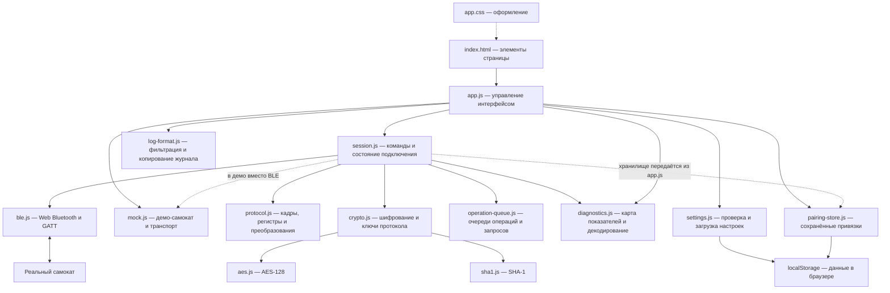
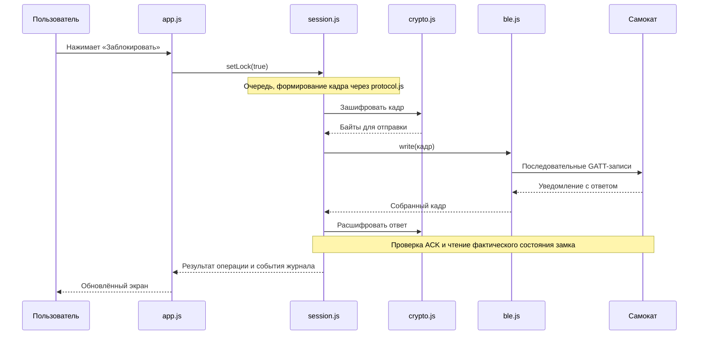

# Карта проекта Mi3 BLE

Приложение — статическая страница на JavaScript. Серверной части, базы данных,
сборщика и внешних runtime-зависимостей нет. Браузер напрямую общается
с самокатом через Web Bluetooth. Настройки и привязки сохраняются в браузере.

## Как связаны основные части

На схеме стрелки означают вызовы и передачу данных. Ответы самоката проходят
обратный путь: транспорт → сессия → интерфейс.



`app.js` также сохраняет настройки, отображает диагностический отчёт и
принимает события журнала/прогресса. `protocol.js` используют несколько
модулей, включая транспорт и криптографию; на схеме показаны основные связи.

## Что где лежит

```text
Mi3-ble/
├── index.html                 Структура интерфейса, подключение app.js
├── app.css                    Цвета, размеры, адаптация под экран
├── manifest.webmanifest       Название, иконки и запуск как веб-приложения
├── favicon.svg                Значок вкладки
├── icons/                     Иконки веб-приложения
├── js/                        Весь исполняемый код
├── docs/                      Документация и иллюстрации
├── .github/ISSUE_TEMPLATE/     Форма сообщения об ошибке на GitHub
├── .gitignore                 Исключения для локальных материалов
├── .idea/                     Добавленные в Git настройки IntelliJ IDEA
├── README.md                  Описание, запуск и возможности
├── SECURITY.md                Как сообщать об уязвимостях
├── LICENSE                    Полный текст лицензии
└── THIRD_PARTY_NOTICES.md       Источники и атрибуция
```

`manifest.webmanifest` задаёт представление веб-приложения, но сам по себе
не обеспечивает офлайн-работу. Service worker в текущем проекте отсутствует.

## Модули JavaScript

| Файл | Для чего используется | Когда его менять |
| --- | --- | --- |
| [app.js](../js/app.js) | Находит элементы HTML, обрабатывает кнопки, создаёт транспорт и сессию, обновляет экран, показывает журнал и JSON-отчёт | Добавление пользовательского действия, изменение поведения кнопок, сообщений и отображения |
| [session.js](../js/session.js) | Полная и сохранённая привязка, замок, статус, диагностика, KERS; ожидание нужных ответов, повторы чтений и ошибки | Изменение логики общения с самокатом и подтверждения команд |
| [ble.js](../js/ble.js) | Выбор устройства, подключение GATT, поиск характеристик, отправка частями и сборка уведомлений в кадры | Проблемы Bluetooth, размеров записей, обрыва или переподключения |
| [protocol.js](../js/protocol.js) | Адреса, команды, регистры, UUID; построение/разбор кадров, checksum, HEX и числовые преобразования | Добавление регистра, изменение формата кадра или интерпретации значения |
| [crypto.js](../js/crypto.js) | Ключи, шифрование пакетов, криптографический трейлер и счётчики Ninebot | Изменения криптографического обмена; происхождение кода связано с NinebotCrypto |
| [aes.js](../js/aes.js) | Низкоуровневое шифрование AES-128 | Только изменения криптографического примитива |
| [sha1.js](../js/sha1.js) | Хеширование SHA-1 для получения ключей протокола | Только изменения криптографического примитива |
| [operation-queue.js](../js/operation-queue.js) | Последовательно запускает асинхронные действия, отменяет ещё не запущенные при закрытии очереди | Изменение общих правил очереди; сессия создаёт отдельные очереди операций и запросов |
| [diagnostics.js](../js/diagnostics.js) | Список диагностических полей, их регистры, длины и декодеры; формирование JSON по разрешённому списку | Добавление показателя, изменение единиц или состава отчёта |
| [settings.js](../js/settings.js) | Значения по умолчанию, загрузка и проверка типов/диапазонов настроек | Добавление настройки или изменение её допустимых значений |
| [pairing-store.js](../js/pairing-store.js) | Сохранение, поиск и удаление подтверждённой привязки по серийнику и имени | Изменение формата хранения или правил забывания привязки |
| [log-format.js](../js/log-format.js) | Краткий/подробный режим журнала, скрытие известных идентификаторов при копировании | Изменение состава и формата экспортируемого журнала |
| [mock.js](../js/mock.js) | Виртуальный самокат и транспорт с тем же интерфейсом обмена | Проверка интерфейса без устройства, новые сценарии демо |

## Путь команды на примере замка



Это путь AES-режима. В режиме без AES криптографический шаг пропускается.
В демо вместо `ble.js` работают `MockTransport` и `MockScooter` из `mock.js`;
высокоуровневые команды остаются в `session.js`.

## Где сохраняются данные

| Данные | Где находятся | Срок жизни |
| --- | --- | --- |
| Настройки и последнее устройство | `localStorage`, ключ `mi3ble.settings.v1` | До очистки данных сайта или изменения настроек |
| Подтверждённая привязка: имя, серийник и app random | `localStorage`, ключ `mi3ble.pairing.v1.<serial>` | До забывания привязки, очистки сайта или удаления недействительного ключа |
| BLE random, производные ключи и счётчики | Объекты текущей сессии в памяти | Для конкретного соединения |
| Журнал и диагностический снимок | Память страницы | До очистки, замены состояния или перезагрузки; экспортированная копия живёт отдельно |
| Скачанный JSON | Файл, сохранённый пользователем | Пока пользователь его не удалит |

Хранилище привязано к адресу сайта: другой домен, протокол или порт означает
другое хранилище. Пользовательские настройки сохраняются браузером,
а не в файлах репозитория.

## Документация в репозитории

- [protocol.md](protocol.md) — техническое описание актуального протокола.
- [shu-profiles.md](shu-profiles.md) — сравнение поведения профилей SHU,
  карта диагностики и ограничения проверки.

Эта карта описывает только файлы, добавленные в Git. Основная точка входа —
корневой `index.html`, который подключает `js/app.js` как браузерный модуль.

## Куда идти с конкретной задачей

| Задача | Начать с |
| --- | --- |
| Добавить/убрать кнопку | `index.html` → привязка событий и состояние в `app.js` |
| Изменить расположение или цвет | `app.css` |
| Добавить показатель диагностики | `diagnostics.js` → поддержка регистра в `protocol.js` и при необходимости `mock.js` |
| Изменить действие команды | `session.js` → формат регистра в `protocol.js` |
| Исправить соединение или запись BLE | `ble.js`; восстановление и UI подключения — `app.js` |
| Изменить сохранение настроек | `settings.js` и `app.js` |
| Изменить повторную привязку | `session.js` и `pairing-store.js`; ключи — `crypto.js` |
| Изменить копируемый журнал | `log-format.js`; кнопка копирования — `app.js` |
| Поднять версию приложения | `APP_VERSION` в `app.js` |
| Подготовить GitHub-публикацию | Основная папка проекта: проверить `.gitignore`, состав файлов и будущий начальный коммит |

Разработка и публикация выполняются из основной папки `Mi3-ble/`.
Отдельной публичной копии больше нет. Рабочие материалы остаются локально
и исключаются через `.gitignore`. После проверки пользователя здесь будут
созданы один чистый начальный коммит и push на GitHub.
